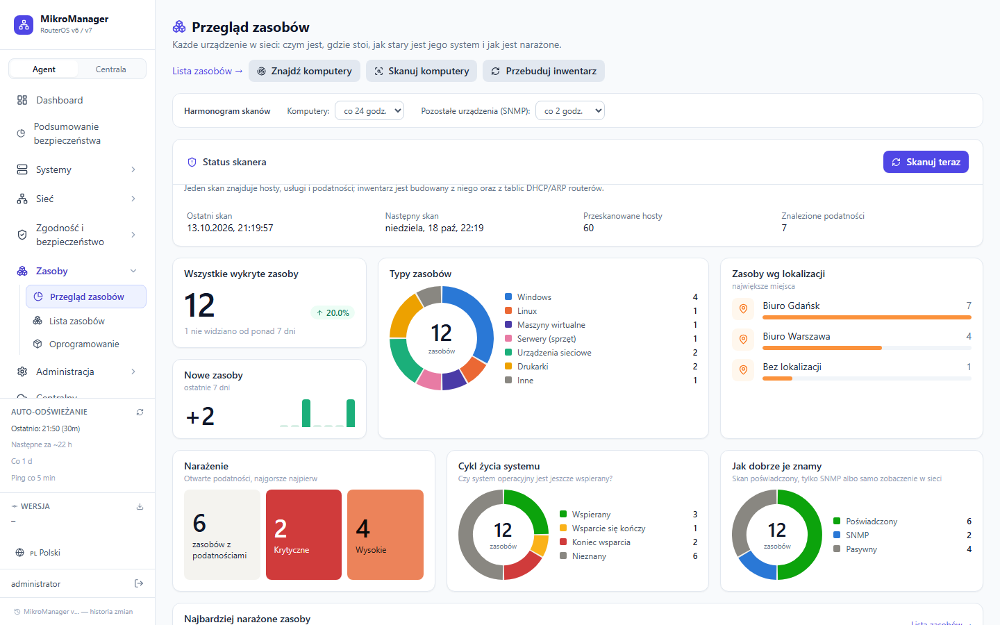
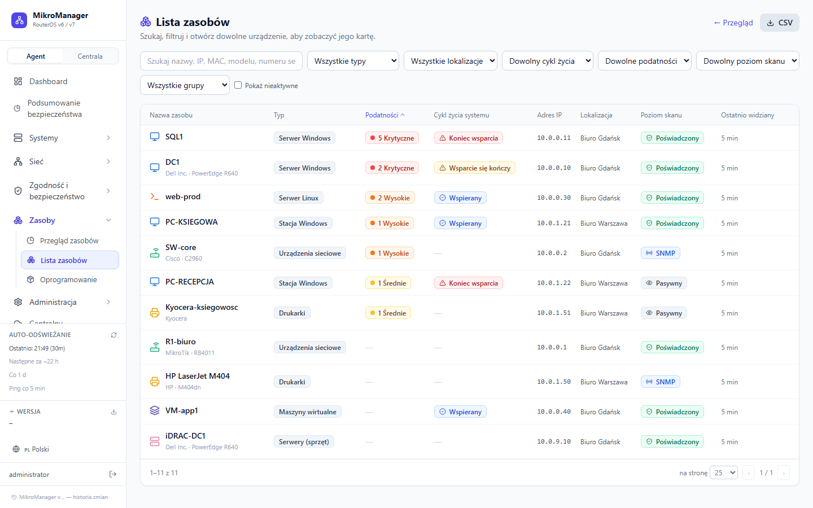
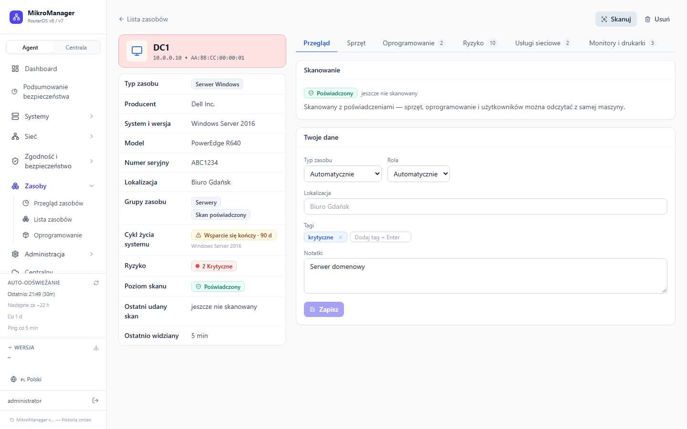
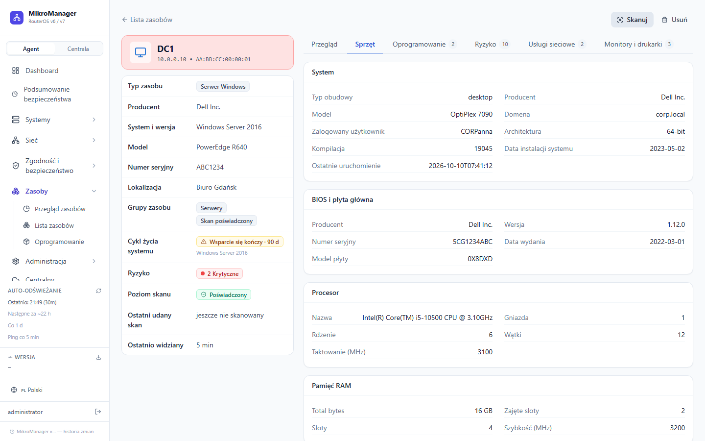
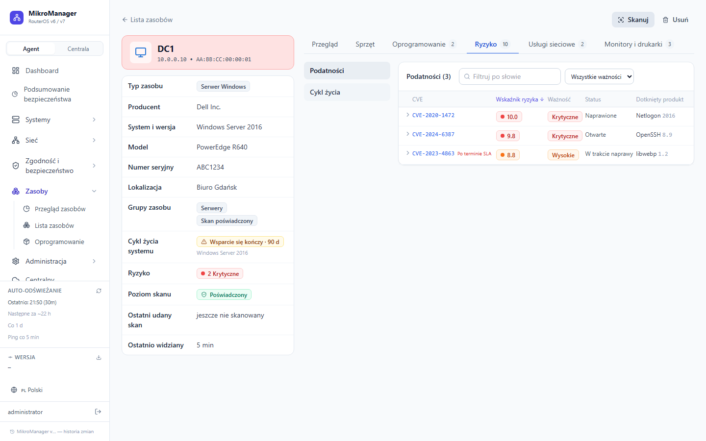
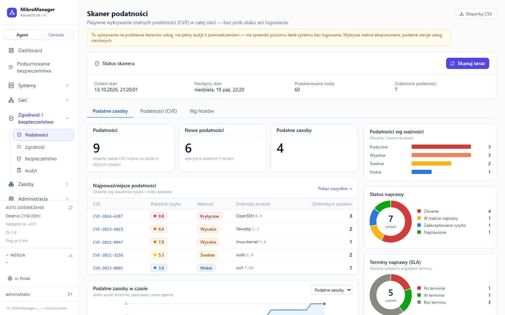
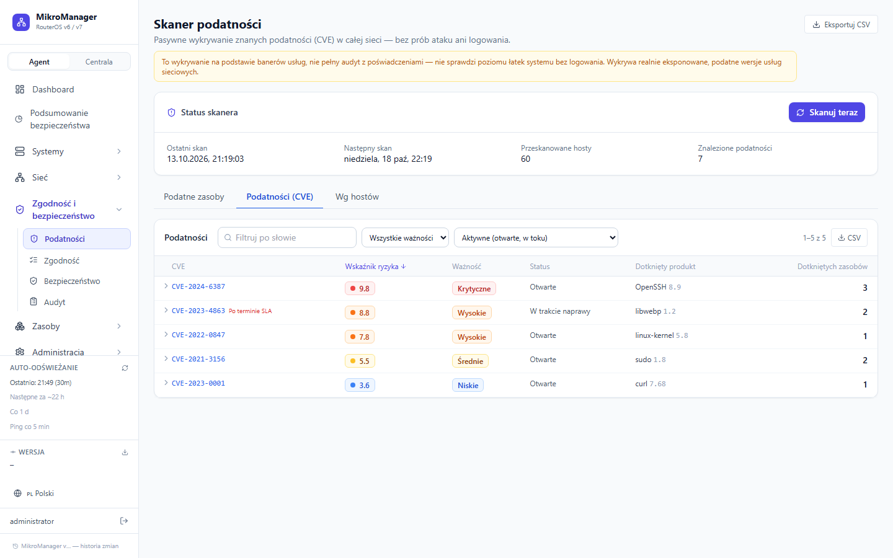
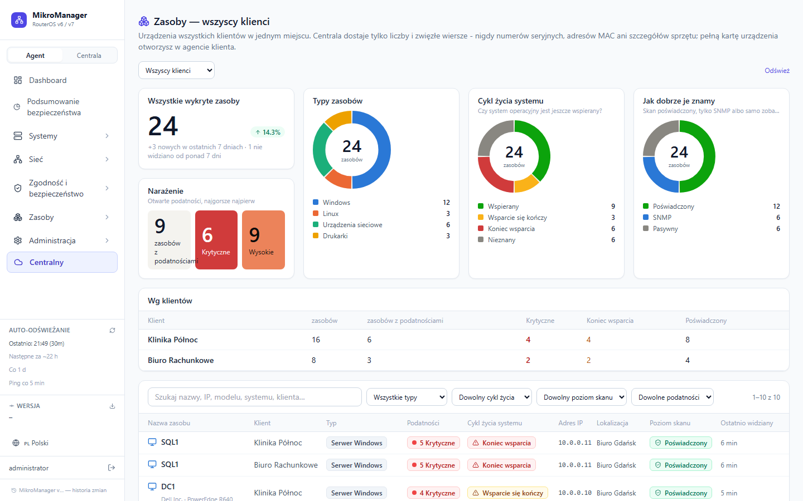
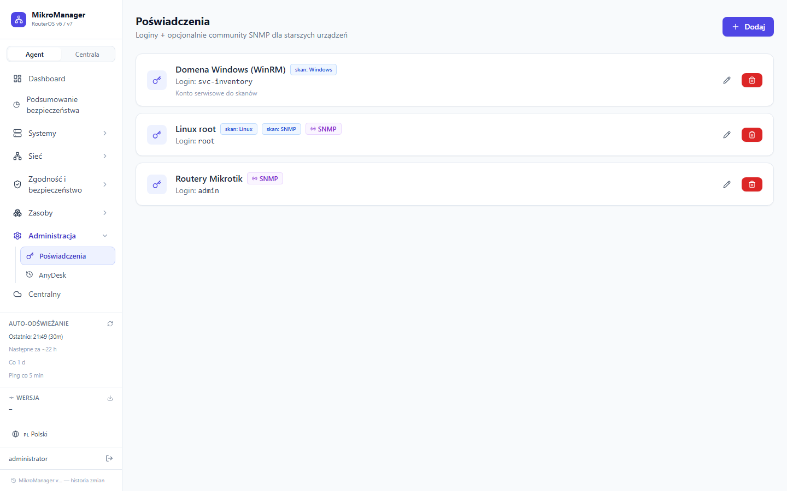

# MikroManager

Aplikacja do zarządzania i monitorowania sieci — urządzenia Mikrotik
(RouterOS v7+, z fallbackiem na starsze wersje i Cisco SB przez SNMP), serwery
Linux i Windows (w tym Hyper-V), komputery, drukarki i reszta sprzętu w tej
samej sieci — z pełną inwentaryzacją, skanem podatności i podsumowaniem
bezpieczeństwa. Jeden lokalny agent (Python + React) na komputerze
administratora, z opcjonalnym centralnym widokiem wielu klientów przez OVH.

## Zrzuty ekranu

Dane na zrzutach są przykładowe (nie pochodzą z prawdziwej sieci).

**Zasoby — przegląd.** Ile jest urządzeń, jakich typów, gdzie stoją, czy ich systemy są jeszcze wspierane i jak dobrze je znamy (skan z poświadczeniami / SNMP / tylko widoczne w sieci). Każdą wartość na wykresach można kliknąć, żeby zobaczyć listę urządzeń za nią.



**Lista zasobów** — wyszukiwanie, filtry (typ, lokalizacja, cykl życia, podatności, poziom skanu), sortowanie, eksport CSV.



**Karta zasobu** — zakładki zależne od typu urządzenia: przegląd, sprzęt (BIOS, procesor, pamięć, dyski, karty sieciowe), oprogramowanie, ryzyko (podatności + cykl życia), usługi sieciowe, monitory i drukarki podłączone do komputera.





**Podatności** — pulpit „Podatne zasoby” (najpoważniejsze CVE, status naprawy, terminy SLA, historia), lista CVE z rozwijaną remediacją oraz widok per host.




**Centrala (OVH)** — zasoby wszystkich klientów w jednym miejscu (bez numerów seryjnych i adresów MAC).



**Poświadczenia** — każde poświadczenie można przypisać do rodzaju skanu (Windows / Linux / SNMP).



## Wymagania

- **Python 3.10+** — backend
- **Node.js 18+** — budowanie frontendu

## Instalacja (jednorazowo)

```powershell
python setup.py
```

Instaluje zależności Python, npm i buduje frontend.

Pełna instrukcja krok po kroku (Windows i Linux, w tym uruchamianie jako
usługa systemowa) — patrz [`docs/instrukcja-instalacji-agenta.docx`](docs/instrukcja-instalacji-agenta.docx).

## Uruchamianie

```powershell
# Produkcyjnie (serwuje zbudowany frontend):
python run.py

# Tryb deweloperski (hot reload obu stron):
python run.py --dev
```

Aplikacja otwiera się automatycznie w przeglądarce na `http://localhost:8888` (prod) lub `http://localhost:5173` (dev).

Port można zmienić przez zmienną środowiskową `MIKROMANAGER_PORT` (np. `MIKROMANAGER_PORT=9000 py run.py`) lub przełącznik `--port`.

## Pierwsze kroki

1. **Poświadczenia** → dodaj login/hasło do routerów (i opcjonalnie wspólne
   poświadczenia SSH/WinRM dla hostów Linux/Windows w zakładkach Linux/Windows)
2. **Skaner** → dodaj zakresy CIDR (np. `192.168.1.0/24`) → uruchom skan —
   jeden przycisk uruchamia zarówno wykrywanie urządzeń Mikrotik/Cisco, jak
   i pełny skan podatności + Linux + Windows (patrz niżej)
3. **Urządzenia** → przypisz poświadczenia do wykrytych urządzeń
4. **Mapa sieci** → ułóż topologię przeciągając węzły
5. **Logi** → wybierz urządzenie i kliknij "Start live"

## Funkcje

- **Urządzenia Mikrotik/Cisco** — REST API v7 (z fallbackiem na binary API
  i SNMP dla starszych/ograniczonych urządzeń), interfejsy, adresy, trasy,
  firewall, wireless, DHCP, tunele L2/VPN (WireGuard/IPsec/EoIP/GRE/VXLAN),
  zasoby (CPU/pamięć/dysk), zdalna aktualizacja firmware, backup konfiguracji.
- **Zasoby (pełna inwentaryzacja)** — jedna lista wszystkiego, co jest w sieci:
  komputery (Windows/Linux), serwery, maszyny wirtualne, urządzenia sieciowe,
  drukarki i reszta. Źródła: tablice DHCP/ARP routerów, skaner podatności,
  hosty Linux/Windows, serwery Dell, Hyper-V oraz własne wykrywanie komputerów
  w zakresach skanowania (ARP + nazwy NetBIOS/DNS — także tam, gdzie zapora
  ukrywa wszystkie porty). Skan z poświadczeniami (read-only): Windows przez
  WinRM/WMI (numer seryjny, BIOS, procesor, moduły RAM, dyski, karty sieciowe z MAC,
  zalogowany użytkownik, **podłączone monitory, zainstalowane drukarki, USB**),
  Linux przez SSH (DMI, lscpu, lsblk, EDID monitorów, CUPS). Bez poświadczeń —
  podstawowe informacje przez SNMP (nazwa, model, numer seryjny, a dla drukarek
  licznik stron i poziomy tonerów). Cykl życia systemu (wspierany / kończy się /
  koniec wsparcia), podatności per urządzenie, lokalizacja z etykiety zakresu,
  ręczne ustawienie typu i roli. Poświadczenia do skanów wybiera się na stronie
  **Poświadczenia**; harmonogram: komputery raz na dobę, pozostałe urządzenia (SNMP)
  co 2 godziny (do zmiany w „Harmonogramie skanów” na przeglądzie zasobów).
- **Podsumowanie bezpieczeństwa** — jeden pulpit (agent i Centrala): podatności,
  zgodność, zdarzenia i alerty ze wszystkich źródeł.
- **Hyper-V** — graficzna tablica hostów i maszyn wirtualnych, alerty,
  akcje na VM (start/zatrzymanie/restart/checkpoint), widok w Centrali.
- **Serwery Linux/Windows** — tablica z grupami, wspólna aktualizacja i restart grupy.
- **Skanowanie sieci** — jeden, wspólny mechanizm: wykrywanie urządzeń
  Mikrotik/Cisco po CIDR, cotygodniowy skan podatności (CVE), odświeżanie
  wersji RouterOS na znanych urządzeniach oraz wykrywanie hostów Linux/
  Windows — wszystko wyzwalane z jednego miejsca (zakładka **Skaner**),
  każde na swoim harmonogramie.
- **Podatności (CVE)** — pasywne wykrywanie wersji usług sieciowych +
  sprawdzenie w NVD/vulners.com/OSV.dev, pełny audyt pakietów dla hostów z
  działającymi poświadczeniami, śledzenie remediacji (status/notatka/SLA);
  pulpit z historią dzienną podatnych zasobów, lista CVE i widok per host.
- **Zarządzanie Linux** (apt/dnf) — wykrywanie hostów, sprawdzanie/instalacja
  aktualizacji, uruchamianie skryptów, monitoring dysku/pamięci.
- **Zarządzanie Windows** (Windows Update) — jak wyżej, plus wykrywanie
  domeny/typu hosta (serwer/stacja robocza), obserwowane usługi (Get-Service),
  lista nietypowych otwartych portów dla stacji roboczych.
- **Monitoring zasobów** — zajętość dysku i pamięci (Linux/Windows/Mikrotik),
  przeciążenia i błędy/drops na interfejsach sieciowych (Mikrotik) — z
  alertami Telegram przy przekroczeniu progu.
- **Zgodność (compliance)** — podstawowe sprawdzenia hardeningu konfiguracji
  (SSH/RDP/firewall/domyślne hasła) dla Linux/Windows/RouterOS.
- **Oprogramowanie** — lista zainstalowanego oprogramowania per host, z filtrem
  zasobu (z karty zasobu prowadzi tu link „Otwórz w Oprogramowaniu”).
- **AnyDesk** — lokalna historia połączeń (z plików trace, bez potrzeby
  płatnego API) do rozliczania czasu pracy u klientów.
- **Centrala (OVH)** — opcjonalny, szyfrowany E2E widok wielu klientów z
  jednego miejsca: alerty, status urządzeń, zdalne komendy (aktualizacja
  firmware/agenta, restart, skan), zarządzanie użytkownikami.
- **Bezpieczeństwo agenta** — logowanie z MFA (TOTP, kody jednorazowe), dziennik
  audytu akcji, automatyczna aktualizacja agenta z git (opcjonalna), szyfrowane
  poświadczenia (Fernet), ciasteczko sesji `HttpOnly` + `SameSite=Strict`,
  limit prób logowania per źródło, nagłówki bezpieczeństwa (CSP). Wynik
  audytu: [`docs/SECURITY-AUDIT-2026-10-13.md`](docs/SECURITY-AUDIT-2026-10-13.md);
  HTTPS przed agentem: [`docs/https-za-reverse-proxy.md`](docs/https-za-reverse-proxy.md).

## Skaner podatności (CVE)

Cotygodniowy skan całej sieci (bez logowania/exploitów) — wykrywa otwarte
usługi i sprawdza ich wersje w publicznych bazach CVE. Ten sam przebieg
odświeża też wersję RouterOS na znanych urządzeniach (żeby nie polegać
wyłącznie na osobnym, dobowym cyklu odświeżania) i wyzwala wykrywanie
hostów Linux/Windows — patrz `services/vuln_scan.py`. Trzy źródła CVE:

- **NVD** (nvd.nist.gov) — zawsze aktywne, klucz opcjonalny (podnosi limit
  zapytań): `MIKROTIK_NVD_API_KEY`.
- **vulners.com** — opcjonalne, dokładniejsze dopasowanie CVE (przez CPE, nie
  samo wyszukiwanie tekstowe); wymaga darmowej rejestracji na vulners.com i
  klucza API: `MIKROTIK_VULNERS_API_KEY` (puste = pominięte).
- **OSV.dev** (api.osv.dev) — dodatkowe, darmowe źródło dla pakietów
  Debian/Ubuntu, bez klucza API.

Dla hostów, gdzie już działają zapisane poświadczenia (SSH/WinRM), skaner
opcjonalnie idzie głębiej niż sama wersja systemu — pełny audyt
zainstalowanych pakietów/oprogramowania przez `vulners.com` (wymaga
`MIKROTIK_VULNERS_API_KEY`, jak wyżej). Rzadziej niż zwykły cotygodniowy
skan, bo to "cięższa" operacja (potencjalnie tysiące pakietów na raz):
domyślnie raz na 7 dni per host, zmienialne przez
`MIKROTIK_VULN_PACKAGE_AUDIT_DAYS`.

## Monitoring zasobów i sieci

Dysk/pamięć (Linux przez SSH, Windows przez WinRM, Mikrotik przez
`/system/resource`) oraz błędy/przeciążenia interfejsów (Mikrotik) —
`services/resource_monitor.py`. Mikrotik sprawdzany raz na godzinę
(`MIKROTIK_DEVICE_RESOURCE_CHECK_MIN`, żeby nie zasypywać logów routerów
logowaniami), Linux/Windows co 30 min (`MIKROTIK_RESOURCE_CHECK_MIN`) — SSH/WinRM
jest za "ciężkie" na cykl 2-minutowy. Kto i jak często loguje się do routerów,
pokazuje `/api/system/device-access`. Progi alarmowe (Telegram, z histerezą):

- `MIKROTIK_DISK_ALERT_PCT` (domyślnie 90%)
- `MIKROTIK_MEM_ALERT_PCT` (domyślnie 90%)
- `MIKROTIK_IFACE_ERROR_COOLDOWN_SEC` (domyślnie 1800s) — jak często
  najwyżej może odezwać się alert błędów/drops na tym samym interfejsie
- próg Mbps dla przeciążenia łącza ustawiany ręcznie per urządzenie
  (zakładka Urządzenia → wybrane urządzenie → "Sieć"), domyślnie wyłączony

## Zmienne środowiskowe (wybrane)

| Zmienna | Domyślnie | Znaczenie |
|---|---|---|
| `MIKROMANAGER_HOST` / `MIKROMANAGER_PORT` | `0.0.0.0` / `8888` | adres i port agenta (za reverse proxy ustaw `127.0.0.1`) |
| `MIKROMANAGER_COOKIE_SECURE` | `0` | `1` = ciasteczko sesji tylko po HTTPS |
| `MIKROMANAGER_SESSION_HOURS` | `168` | ważność logowania (godziny, maks. 720) |
| `MIKROMANAGER_API_DOCS` | `0` | `1` = udostępnij `/docs` i `/openapi.json` |
| `MIKROTIK_ASSET_SCAN_HOURS` / `MIKROTIK_ASSET_DEVICE_SCAN_HOURS` | `24` / `2` | częstotliwość skanów komputerów / pozostałych urządzeń (zmienialna też w interfejsie) |
| `MIKROTIK_LAN_SWEEP_HOURS` | `6` | jak często wykrywane są komputery w zakresach skanowania |
| `MIKROTIK_ASSET_DIRECTORY_SEC` | `7200` | jak stara może być kopia tablic DHCP/ARP przy przebudowie inwentarza |
| `MIKROTIK_DEVICE_RESOURCE_CHECK_MIN` | `60` | odpytywanie zasobów routerów (minuty) |

## Struktura projektu

```
mikrotik/
├── backend/
│   ├── main.py                    # FastAPI app + rejestracja tła (refresher, uplink, skanery...)
│   ├── api/                       # Routery FastAPI — po jednym per obszar (devices, credentials,
│   │   │                          # scanner, vuln_scan, linux_manage, windows_manage, compliance,
│   │   │                          # inventory, anydesk_history, logs, audit, auth, system)
│   ├── services/
│   │   ├── mikrotik_client.py     # RouterOS REST/API/SNMP client (+ cisco_client.py, snmp_client.py)
│   │   ├── scanner.py             # Async wykrywanie urządzeń po CIDR
│   │   ├── vuln_scan.py           # Skan podatności (CVE) — banery + wersje urządzeń, cotygodniowy
│   │   ├── linux_manage.py        # Patch management Linux (apt/dnf) przez SSH
│   │   ├── windows_manage.py      # Patch management Windows (Windows Update) przez WinRM
│   │   ├── resource_monitor.py    # Dysk/pamięć/interfejsy — progi + alerty
│   │   ├── tunnel_monitor.py      # Status tuneli VPN (WireGuard/IPsec/EoIP/GRE/VXLAN)
│   │   ├── assets.py              # Inwentarz zasobów (+ asset_lifecycle, asset_scan*, lan_sweep)
│   │   ├── compliance.py          # Sprawdzenia hardeningu (Linux/Windows/RouterOS)
│   │   ├── refresher.py           # Cykliczne odświeżanie tożsamości/wersji urządzeń
│   │   ├── firmware.py            # Aktualizacja firmware RouterOS + backup konfiguracji
│   │   ├── anydesk_history.py     # Lokalna historia połączeń AnyDesk (pliki trace)
│   │   ├── uplink.py              # Szyfrowany snapshot do Centrali (OVH)
│   │   ├── updater.py             # Samo-aktualizacja agenta z git
│   │   ├── auth.py / ovh_auth.py  # Logowanie lokalne (MFA) / logowanie kontem OVH
│   │   └── crypto.py              # Szyfrowanie poświadczeń (Fernet)
│   ├── models/database.py         # SQLAlchemy + SQLite (migracje w _migrate_add_columns())
│   └── requirements.txt
├── frontend/src/
│   ├── pages/                     # Dashboard, Devices, Scanner, Vulnerabilities, LinuxHosts,
│   │                              # WindowsHosts, Compliance, Inventory, Software, AnydeskSessions,
│   │                              # NetworkMap, Logs, Credentials, Security, AuditLog, Central*
│   ├── components/                # Sidebar, UI komponenty, RunScriptModal, VulnScanStatusPanel
│   └── lib/api.ts                 # Axios klient API
├── ovh/                           # Opcjonalny backend Centrali (PHP+MySQL na współdzielonym
│   │                              # hostingu) + statyczny podgląd z telefonu (ovh/viewer/)
├── data/                          # SQLite DB + klucz szyfrowania (auto-created)
├── run.py                         # Launcher (z pętlą auto-restartu po self-update)
└── setup.py                       # Instalator
```

## Komunikacja z urządzeniami

- **RouterOS REST API** (port 80/443, `/rest/`) — główna metoda dla ROS v7
- **Mikrotik API** (port 8728/8729) — fallback via `librouteros`
- **SNMP v2c** — fallback dla starszych/ograniczonych urządzeń oraz Cisco SB
- **SSH** (paramiko) — Linux (apt/dnf, dysk/pamięć) oraz identyfikacja/audyt
  pakietów na dowolnym hoście z otwartym portem 22
- **WinRM** (pywinrm) — Windows (Windows Update, usługi, dysk/pamięć)
- Logi: SSE stream, bez składowania lokalnie
